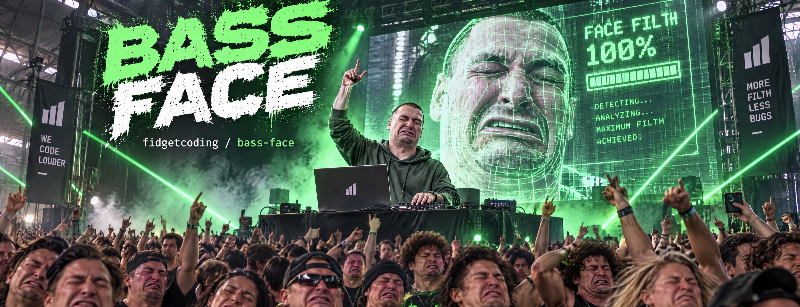
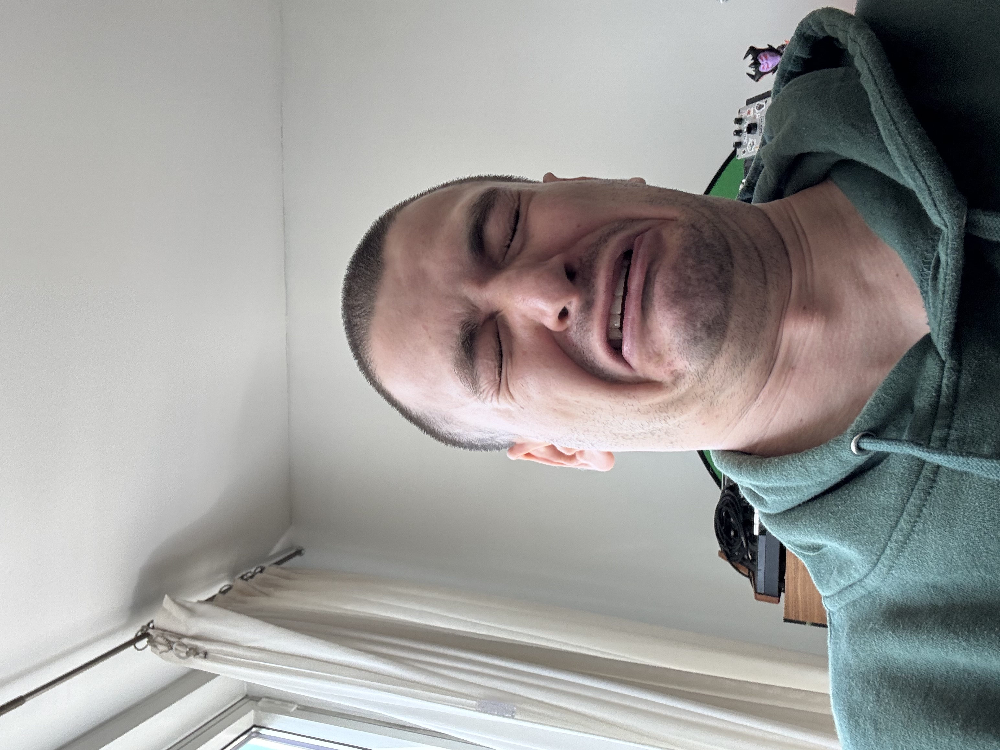
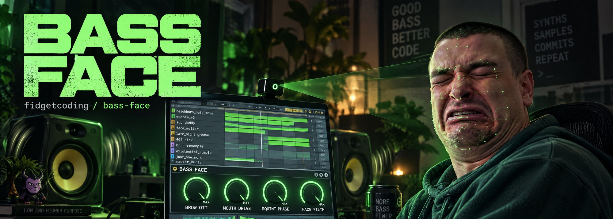
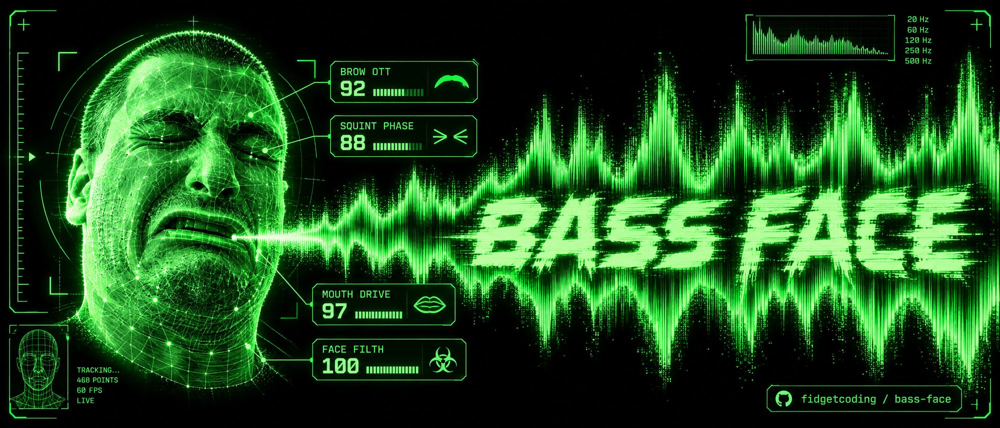
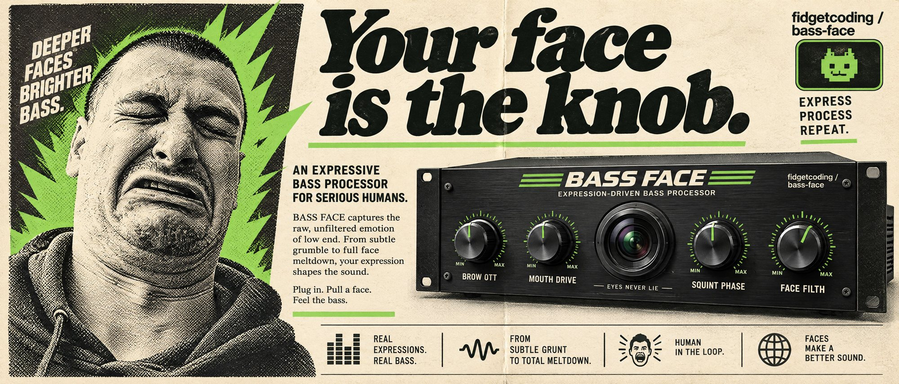

<a id="top"></a>



# Bass Face

**Pull a bass face at your webcam and your Ableton rack pulls one right back.**

Short version: [ESSENCE.md](ESSENCE.md). How it got built in one day: [EVOLUTION.md](EVOLUTION.md). What it touches on your Mac: [SECURITY.md](SECURITY.md).

> [!NOTE]
> **Heads up, this was fidgetcoded.** I built it in one day for my own Mac, my own face and my own rack, and it plays great there. There's no app to download yet: you set up the Python side yourself and copy the device and my rack into Live. Every step is below. If one of them is off on your Mac, open an issue.

<p align="center">
  
  <br>
  <em>The face in question. A bass face is what your face does on its own when you hear the nastiest, crunchiest, most violent, most mind-blowing sound design.</em>
</p>

## What it is

Bass Face turns your face into four knobs for Ableton Live 12.

A small Python program watches your webcam with Google's MediaPipe and reads four faces: eyebrows up, mouth open, squint, and the full bass face. It sends them into Live two ways at once: as MIDI from a virtual source called **Bass Face** (CC 20 to 23), and as OSC to a Max for Live device. The device finds four macros by name on its track and drives them.

It makes no sound of its own. Two halves: the tracker is the hands, your rack is the sound.

The four faces work like a ladder. Eyebrows first, then the mouth, then the squint, then the full bass face. Each step locks the ones below it at their peak, so the sound keeps stacking while your face changes shape. When your face drops back to neutral, everything drains together.

## Why I made it

I pull this face every time a bass line lands right. Pretty much everyone who makes bass music does; it's practically a meme. So in May I wrote it down as an idea: if I'm making the face anyway, the face should do something. The harder I pull it, the harder the track hits.

My first sketch was a distortion plugin with a webcam bolted on. When I sat down to build it on July 19, I made it a controller instead, so you keep your own OTT and your own distortion and Bass Face just moves the knobs. I built it with Claude Code in one sitting, from that note to a playable instrument a little before midnight. [EVOLUTION.md](EVOLUTION.md) has every round, including the bug that took six or more tries.

## Install and first run



*Full bass face, all four dials at max.*

You need:

- A Mac with a webcam. I run it on macOS 26 with the built-in camera.
- Ableton Live 12. The device needs Max for Live, which comes with Suite. The plain MIDI route works without it.
- Python 3.12. If you don't have it: `brew install python@3.12`.

There are two parts: the tracker (Python) and the Live side (pick the MIDI route, the device, or both).

### 1. The tracker

```sh
git clone https://github.com/fidgetcoding/bass-face.git ~/code/bass-face
cd ~/code/bass-face
python3.12 -m venv .venv
.venv/bin/pip install -r requirements.txt
.venv/bin/python tracker/core.py
```

Clone it to `~/code/bass-face` if you can. That's where the Live device looks for it. Somewhere else works too; see [step 3](#3-live-the-full-way-the-device).

`requirements.txt` pins the versions I run, including MediaPipe 0.10.35. A fresh unpinned install pulls a newer MediaPipe that I haven't tried.

What happens on the first run:

1. **macOS asks if your terminal can use the camera.** Allow it. If you said no earlier, the tracker stops with "camera unavailable"; turn it on in **System Settings → Privacy & Security → Camera**.
2. **A window called Bass Face asks "THIS CAMERA?"** It picks your Mac's built-in camera on its own, so an iPhone on Continuity Camera can't grab it. Press **c** to switch cameras, **Enter** to start.
3. **Calibration runs,** about 30 seconds. It's under [How calibration works](#how-calibration-works).
4. **You're tracking.** The window shows your face mesh and four bars, and the terminal shows the same four meters.

Keys, with the Bass Face window in front:

| Key | Does |
|---|---|
| `c` | Switch camera |
| `1` to `4` | Send only that CC |
| `0` | Send all four again |
| Head shake | Unlock everything |
| `q` | Quit |

Ctrl-C in the terminal quits too.

Flags for `tracker/core.py`:

| Flag | Does |
|---|---|
| `--recalibrate` | Redo calibration |
| `--camera N` | Use camera N |
| `--no-preview` | Terminal only |
| `--no-midi` | No MIDI port |
| `--no-osc` | No OSC |
| `--debug` | Log to debug.log |
| `--autostart` | Skip camera check |

The device uses `--autostart` when it launches the tracker for you.

### 2. Live, the quick way: plain MIDI

Works in any Live 12 edition, no Max for Live needed.

1. Start the tracker. In Live, open **Settings → Link, Tempo & MIDI**. Under MIDI Ports, find the input **Bass Face** and turn on **Remote**.
2. Press **⌘M** for MIDI Map Mode and click the knob you want on your eyebrows.
3. Click the Bass Face window, press **1**, and raise your eyebrows. Live assigns CC 20.
4. Repeat for the rest: **2** for the mouth (CC 21), **3** for the squint (CC 22), **4** for the bass face (CC 23).
5. Press **0** in the Bass Face window when you're done. Until you do, only the solo CC is sent and the other three knobs sit frozen. The terminal shouts about it so you don't forget.

Why the solo keys: all four faces stream at once, so without them Live grabs whichever CC wiggled first.

This route records: with Automation Arm on, Live writes your face moves as automation on whatever you mapped.

### 3. Live, the full way: the device

Drop the device on a track and the camera turns on by itself. Four macros named **BROW OTT**, **MOUTH DRIVE**, **SQUINT PHASE** and **FACE FILTH** follow your face. No mapping, and it finds them again after every reload.

**Install the device and my rack.** From your bass-face folder:

```sh
LIB="$HOME/Music/Ableton/User Library/Presets/Audio Effects"
mkdir -p "$LIB/Max Audio Effect" "$LIB/Audio Effect Rack"
cp device/BassFace.amxd m4l/bassface_map.js m4l/bassface_launcher.js "$LIB/Max Audio Effect/"
cp "device/BASS FACE RACK.adg" "$LIB/Audio Effect Rack/"
```

The two `.js` files have to sit next to `BassFace.amxd`; the device looks for them there. Moved your User Library? Swap in your path (Live shows it under **Settings → Library**).

In Live's browser, under **User Library → Presets → Audio Effects**, drag **BASS FACE RACK** onto a track with something bassy on it, then drag **BassFace** from **Max Audio Effect** onto the same track after the rack. That's it: the rack's four macros already have the right names.

The rack is the one I play: BROW OTT, MOUTH DRIVE, SQUINT PHASE and FACE FILTH fan out to three OTTs, a Saturator, a Phaser-Flanger and an Overdrive. Use it as is, or as a starting point.

<details>
<summary>Build the device from source instead</summary>

1. In Live, drag a **Max Audio Effect** onto the track with your rack and click its edit button. Max opens the device.
2. In Max, open `m4l/BassFace-map.maxpat` with **File → Open**. It opens in presentation view. Unlock it with **⌘E**, switch to the patching view with **⌥⌘E**, then select all (**⌘A**) and copy (**⌘C**).
   Do that select-all in the patching view. In presentation view ⌘A only grabs what's on the device face, and you'd paste a gutted device. Ask me how I know.
3. Back in the device's window: unlock it, select everything that's already there, delete it (the patch brings its own audio in and out), and paste.
4. In the patcher inspector, tick **Open in Presentation**, so Live shows the clean device face.
5. Save it as `BassFace.amxd` in your User Library's `Presets/Audio Effects/Max Audio Effect` folder.
6. Copy `m4l/bassface_map.js` and `m4l/bassface_launcher.js` into that same folder, next to `BassFace.amxd`.

</details>

**Your own rack instead:** on the same track, give four macros on any rack these exact names, capitals and spaces included:

```text
BROW OTT
MOUTH DRIVE
SQUINT PHASE
FACE FILTH
```

Map each macro to whatever you want that face to do. The device searches every device on its track and one level into rack chains, and drives each macro across its full range: neutral face at the bottom, your calibrated max at the top. Added or renamed a macro after the device loaded? Hit **rescan** on the device.

**Let it start the tracker:** the device runs `tracker/core.py --autostart` with the Python in `~/code/bass-face/.venv` when it loads, and stops it when you delete the device or quit Live. Cloned somewhere else? Put that folder's full path in a one-line file called `~/.bassface` (Live doesn't pass your shell's environment variables to the device, so a file it is). From your bass-face folder:

```sh
echo "$PWD" > ~/.bassface
```

The first time the device turns the camera on, macOS asks whether **Ableton Live** can use it, because the tracker runs as Live's child. Allow it. The **CAM** toggle on the device stops and starts the tracker. If one is already running from your terminal, the device leaves it alone and uses that.

Do your first run from the terminal (step 1) so calibration happens in a window you're watching. If there's no calibration yet, a tracker started by the device runs it too.

**Recording a take:** the device moves your macros as modulation, the same way Live's own LFO device does, so Live doesn't record those moves as automation. Record the device's own four dials (OTT, Drive, Phase, Filth) instead, which are normal automatable parameters, or use the MIDI route above.

Pick one route per macro. Once the device worked, I deleted my old MIDI mappings so the two weren't both steering the same knobs.

### Let your agent set it up

Paste this into Claude Code (or any coding agent with a terminal):

```text
Set up the Bass Face tracker from https://github.com/fidgetcoding/bass-face on this Mac.
Clone it to ~/code/bass-face, make a Python 3.12 venv at .venv and install
requirements.txt into it. Then run tests/test_engine.py and tests/test_outputs.py with
the venv's Python (skip test_outputs.py if Ableton Live is open). Don't run
tracker/core.py yourself: it turns on my camera and calibrates on my face, so give me
the command. Then copy the device and rack into my Live User Library as README step 3 shows.
```

## How calibration works



*How the tracker sees me, give or take the lasers.*

Bass Face can't know your face until it's seen it, so the first run is a guided session on camera, about 30 seconds:

1. **Neutral.** Two ticks count down, then you hold a dead face for 2 seconds. That sets each channel's resting floor (the median of what it saw).
2. **Four sweeps,** 4 seconds each, with a countdown before each one. Every sweep starts neutral and goes to your max: eyebrows as high as they go, mouth to the widest O, squint as hard as you can, then the full disgust bass face. Your max is the 95th percentile of the sweep, so one freak frame can't set it.
3. **Done.** It saves `calibration/profile.json` and starts tracking.

It talks to you with macOS system sounds: Tink counts down, Pop means it's capturing, Glass means it got it, and Hero means you're finished.

Full scale sits at 90% of your calibrated max, because the true max is hard to hit again in the middle of a song.

If a face barely registered (less than 0.05 between rest and max), the terminal says so; run it again with `--recalibrate`. If it got fewer than 10 usable frames, it stops and asks about your lighting.

Your profile stays yours. `calibration/profile.json` is in `.gitignore` and never leaves your Mac. Redo it any time:

```sh
.venv/bin/python tracker/core.py --recalibrate
```

It keeps learning while you play, too. For the first 2.5 seconds after launch it learns your resting face fast and ignores expressions, so a stale floor can't fire off a phantom phrase. After that, two safety valves re-zero the floors if your resting face drifts (hood up, head tilted, the light changed) and a phrase gets stuck on.

The five photos in `calibration/photos/` are my face in each phase. Before the webcam session existed, I ran them through MediaPipe (`tracker/analyze_photos.py`) to get a starting calibration, `calibration/nate-v1.json`. The tests still use it. Your tracking uses your own profile.

## What the four faces do



*The ad I'd run if I had a catalogue.*

| Face | Macro | MIDI | In my rack |
|---|---|---|---|
| 1. Eyebrows up | BROW OTT | CC 20 | OTT amount |
| 2. Mouth wide O | MOUTH DRIVE | CC 21 | Saturator drive |
| 3. Squint | SQUINT PHASE | CC 22 | Phaser-Flanger |
| 4. Full bass face | FACE FILTH | CC 23 | Overdrive |

MIDI goes out on channel 1, values 0 to 127, and only when a value changes. OSC goes to `127.0.0.1:7400` as floats from 0 to 1, at `/bassface/ott_brow`, `/bassface/drive_mouth`, `/bassface/phase_squint` and `/bassface/filth_disgust`.

What MediaPipe watches for each one: the brow raise (inner and outer), how far your jaw opens, how hard your eyes squint and close, and how far your brows pull down. That last one surprised me. The obvious pick for a disgust face is the nose sneer, but on my face MediaPipe read the sneer as 0.000 in every photo. Brows pulled down split the bass face (0.50) from plain closed eyes (0.02) cleanly, so FACE FILTH watches your brows crunch.

**The ladder:**

- A face counts as engaged at 35%.
- Once a higher face engages, every face below it **locks** at its peak. That matters because squinting drags your eyebrows down, which would close the OTT right when you're building. The preview marks locked channels LOCK.
- Jump straight to the **full bass face** and the three below it sweep to 100% in 400 ms. Only the full bass face does that. Opening your mouth alone doesn't drag the OTT up.

**Coming down:**

- When the top face you reached falls hard (from above 60% to under 25%), everything starts draining right away.
- The locked faces follow that top one down, so all four hit zero at the same moment your face does.
- A neutral face held for 350 ms releases everything too.
- A blink spikes the squint for about 100 ms. Changes have to last 150 ms to count, so blinking doesn't stop a release or start one.
- **Shake your head** (three quick side to side turns) to unlock everything on the spot. The preview flashes UNLOCKED.

## What's in it

- **The device and my rack, ready to drop in.** `device/BassFace.amxd` and `device/BASS FACE RACK.adg` are the exact files I play with.
- **Four faces, four knobs,** in ladder order, with locks on the way up and one shared drain on the way down.
- **Auto-wire by name.** Name four macros and the device finds them. It looks them up fresh on every load, so it survives set reloads and track moves. I proved it by opening a brand new set from my template: the macros followed my face with zero setup.
- **Starts its own camera.** The device launches the tracker when it loads and stops it when it unloads. The CAM toggle shows whether it's actually running.
- **MIDI and OSC at the same time.** MIDI for mapping anything and recording automation, OSC for the device. Turn either off with `--no-midi` or `--no-osc`.
- **Solo keys** for clean MIDI mapping.
- **Guided calibration** with sounds, so you can do it without looking at the terminal.
- **The right camera.** It lists cameras in the exact order OpenCV does and takes the Mac's built-in one by type, so a phone joining as a webcam can't take over. Press `c` to cycle.
- **Head-shake unlock** for when you want out of a phrase now.
- **A debug log.** `--debug` writes every frame's engine state to `debug.log` as CSV. That's how I finally caught the release stall.
- **All on your Mac.** The face model runs locally and the only thing it sends is OSC to your own machine. Details in [SECURITY.md](SECURITY.md).

### Check it without a camera

```sh
.venv/bin/python tests/test_engine.py
.venv/bin/python tests/test_outputs.py
```

`test_engine.py` runs 19 tests of the ladder, locks, releases and floor learning on made-up face data. `test_outputs.py` runs 3: it opens a virtual MIDI port called "Bass Face Test" and sends OSC to port 7400, so close Live first if the device is loaded. All 22 passed on November 6, 2026, on macOS 26 with Python 3.12.13.

## Known limits

- **Mac only.** The virtual MIDI port, the camera picking, the calibration sounds and the device's launcher all lean on macOS. I've only run it on macOS 26.
- **Live 12.** I built the device on Live 12 Suite. The MIDI route needs no Max for Live.
- **No app yet.** You set up the Python side yourself, and the device and rack are files you copy into Live.
- **A webcam and some light.** It reads one face. Too dark and calibration stops.
- **Sunglasses hurt.** Dark lenses hide your eyes and brows, so the eyebrow and squint faces read badly. A fallback that moves the OTT with your head tilt instead is planned and not built.
- **One face, one profile.** It tracks one face and keeps one calibration file. I've only ever calibrated my own face, so tell me how yours goes.
- **Fixed ports.** OSC is `127.0.0.1:7400` and MIDI is channel 1, CC 20 to 23. They're constants at the top of `tracker/outputs.py`, and the device listens on 7400.
- **Macro moves don't record.** See [Recording a take](#3-live-the-full-way-the-device).
- **CAM off stops any tracker.** If the device didn't start the tracker itself, switching CAM off stops every running `tracker/core.py`, including one you started in a terminal.

## Uninstall

Delete the bass-face folder and `~/.bassface` if you made one. In your User Library's `Presets/Audio Effects/Max Audio Effect` folder, delete `BassFace.amxd`, `bassface_map.js` and `bassface_launcher.js`, and delete `BASS FACE RACK.adg` from `Audio Effect Rack`. In Live's MIDI settings, the Bass Face port disappears once the tracker is gone.

## Credits

- **Face tracking:** [MediaPipe Face Landmarker](https://ai.google.dev/edge/mediapipe/solutions/vision/face_landmarker) by Google. The model bundle in `models/face_landmarker.task` (face detector, face mesh and blendshape models) is Google's work under the [Apache License 2.0](https://www.apache.org/licenses/LICENSE-2.0), per its model cards.
- **Smoothing:** the [1€ filter](https://gery.casiez.net/1euro/) by Géry Casiez, Nicolas Roussel and Daniel Vogel.
- **Built on** [OpenCV](https://opencv.org) (Apache 2.0), [python-rtmidi](https://github.com/SpotlightKid/python-rtmidi) (MIT), [python-osc](https://github.com/attwad/python-osc) (public domain) and [PyObjC](https://github.com/ronaldoussoren/pyobjc) (MIT).
- **Face, rack and bad ideas:** Nate Davidovich.

## License

MIT. See [LICENSE](LICENSE). The MediaPipe model in `models/` keeps its own Apache 2.0 license.

---

<div align="center">

[](https://x.com/fidgetcoding) [](https://www.linkedin.com/in/nate-davidovich/) [](https://youtube.com/@fidgetcoding)

Built by [Nate Davidovich / Lorecraft](https://github.com/fidgetcoding) · more at [fidgetcoding.com](https://fidgetcoding.com)

</div>

[⤴ back to top](#top)
